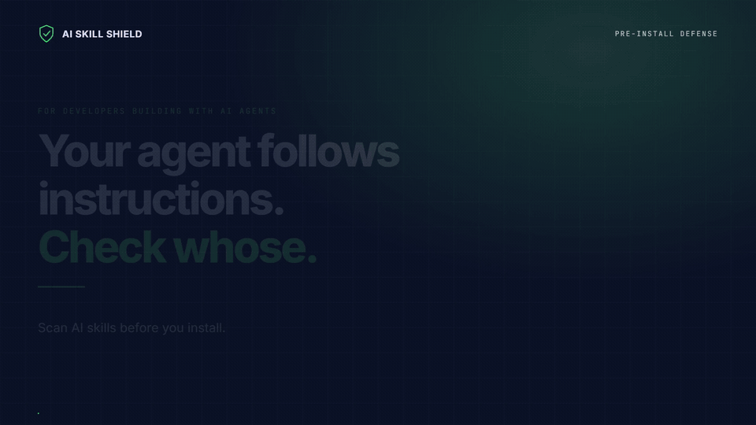
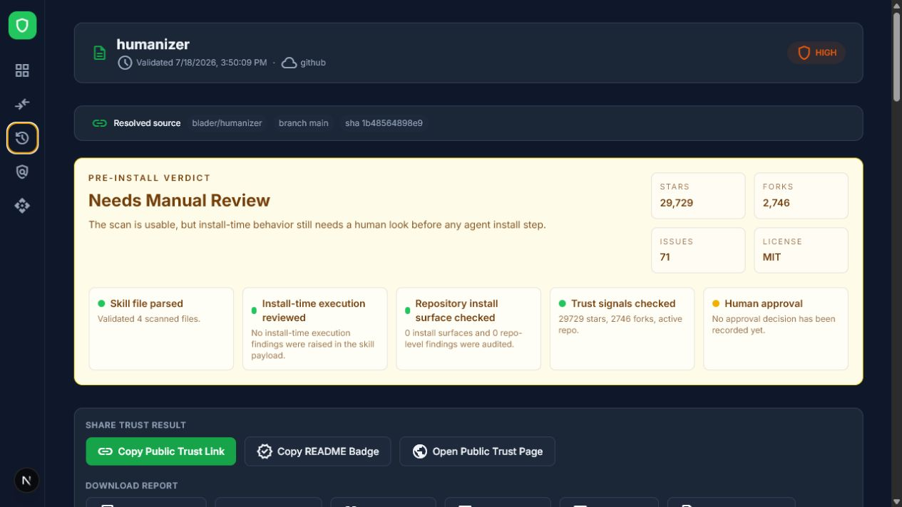

# AI Skill Shield

**Check an AI agent skill before you trust it.**

[](docs/media/skill-shield-launch.mp4)

[Watch or download the 20-second launch video with sound](docs/media/skill-shield-launch.mp4).

The video shows a saved public report from August 8, 2026; its findings are automated scan results, not independently confirmed vulnerabilities.

[Try the live scanner](https://ai-skill-shield.suppeng.com/) - no installation, account, or API key required for the standard scan.

AI Skill Shield reviews `SKILL.md` packages and GitHub repositories for prompt injection, exposed secrets, dangerous commands, install scripts, dependency risks, and other software supply-chain signals before an agent runs or installs them.



## Scan a skill

1. Open the [live scanner](https://ai-skill-shield.suppeng.com/)
2. Paste a GitHub repository URL, upload a skill package, or paste a `SKILL.md`
3. Review the verdict, risky lines, and install-surface evidence

The standard static scan works without an AI provider. Optional AI review supports OpenAI, Anthropic, OpenCode Go, OpenCode Zen, OpenRouter, Gemini, and a locally running OpenCode server when configured.

## Automatic GitHub owner notifications

Repository owners can [install the AI Skill Shield GitHub App](https://github.com/apps/ai-skill-shield) to receive an automatically updated scan issue after each new default-branch scan. The app uses the repository installation token, so it only notifies repositories that explicitly opted in. Configure `GITHUB_APP_ID` and `GITHUB_APP_PRIVATE_KEY`; the app needs **Metadata: read** and **Issues: read/write** permissions. A single issue is updated per skill path and commit SHAs are deduplicated. The issue includes the report link and README badge Markdown, but never changes repository files automatically.

To activate it, create a GitHub App, set its homepage to this deployment, grant those repository permissions, generate a private key, and set both values in the deployment environment. Owners then install the app on selected repositories. No webhook or broad personal-access token is required. Without an installation, scans complete normally and no GitHub notification is sent automatically.

For public repositories, a user may explicitly choose **Notify owner via issue** on a scan report. Set `GITHUB_BOT_TOKEN` to a dedicated, identifiable bot account token to enable this one-time fallback. It is rate limited and only runs after confirmation; it never posts automatically to repositories that have not installed the app.

If that manual notification limit is exceeded, the request is stored and sent by the secured `/api/cron/github-notifications` worker after the one-minute window. Set `CRON_SECRET` in the production environment, then schedule this request every minute on your server:

```cron
* * * * * curl -fsS -H "Authorization: Bearer $CRON_SECRET" https://your-domain.example/api/cron/github-notifications
```

## Appeal a scan report

Repository owners can comment on an automatically created scan issue to challenge findings. AI Skill Shield checks the comment against the original immutable report and exact commit evidence, then posts an auditable assessment. Approved decisions can change effective findings and risk, but never rewrite the original scan or its numerical score. Human approval is required before proposed changes are applied; unavailable evidence remains `insufficient_evidence`. Configure the GitHub App's **Contents: read** and **Issues: read/write** permissions, subscribe to **Issue comment**, and set `GITHUB_WEBHOOK_SECRET`, `SCAN_REVIEW_ADMIN_TOKEN`, and the secured review cron described in [the deployment guide](docs/deployment.md).

If installing an App is not practical, configure `GITHUB_TOKEN` with repository Issues read/write access. The secured `/api/cron/scan-reviews` endpoint polls tracked scan issues, deduplicates comment IDs, and runs the same evidence-based review flow.

## What it checks

- prompt injection and suspicious agent instructions
- exposed API keys, tokens, and private keys
- dangerous shell commands such as `curl | bash` and destructive file operations
- dynamic code execution and excessive file, environment, or network access
- package lifecycle scripts, custom registries, submodules, and GitHub workflows
- skill structure, compatibility, dependencies, and installation risk

## What the report includes

- a `Safe to Review`, `Needs Manual Review`, or `Do Not Install` verdict
- dangerous-line evidence with file and line references
- repository trust metadata and an install-surface map
- findings across 11 validation axes
- JSON, HTML, print-friendly HTML, and SARIF exports
- local report history and approve/reject actions

## Run locally (optional)

The hosted scanner is the fastest path. To keep scans on your own machine:

```bash
git clone https://github.com/adnan-iz/ai-skill-shield.git
cd ai-skill-shield
npm ci
npm run dev
```

Open [http://localhost:3000](http://localhost:3000). For optional AI review, copy `.env.example` to `.env.local` and add a supported provider key.

To use your local OpenCode installation, run `opencode serve --port 4096`, then set `OPENCODE_LOCAL_URL=http://127.0.0.1:4096` in `.env.local`. If you protect that server with `OPENCODE_SERVER_PASSWORD`, set the matching local username and password variables too.

## CLI (source only)

The CLI is not published to npm yet. Build the included shared scanner from the repository root:

```bash
npm ci
npm run build:local-tools
node packages/cli/dist/index.js scan ./path/to/skill
```

The CLI and GitHub Action now use the web security engine, including supporting-file scans, secrets, obfuscation, MCP schemas and permission drift. The web scanner also provides repository audits and the other validation axes. Local scans return an explicit install verdict and coverage evidence; add `--dependencies` for OSV advisories and `--fail-on-incomplete` for strict coverage policy. Run `node packages/cli/dist/index.js mcp` to expose the local `scan_skill` agent tool. See [CLI and baseline usage](docs/cli.md).

Saved reports offer optional deep security scanning through pinned NVIDIA SkillSpector and opt-in source-based AI discovery. AI discovery can identify new issues even when static findings are empty; redacted source is sent only after explicit consent. [Deep scanner setup](docs/deep-scan.md) describes runtime pinning, bounded linked-source scans and separate evidence exports.

GitHub batch scans include supporting files and record omitted, oversized, failed or unsupported content. Incomplete scans and historical reports with unknown coverage require review in reports, badges and Explorer. Exact dependency versions are checked against [OSV](docs/dependency-advisories.md); lookup failures require review rather than implying clean dependencies.

## Current scope

AI Skill Shield performs best-effort static analysis. A clean report means no configured rule found a problem; it is not a guarantee that a skill is safe. AI Skill Shield does not execute untrusted skills or provide a runtime sandbox.

## Tech stack

Next.js 16, React 19, TypeScript, Tailwind CSS 4, Drizzle ORM, and SQLite.

## Documentation

- [Architecture](ARCHITECTURE.md)
- [API reference](docs/api.md)
- [CLI reference](docs/cli.md)
- [Scanner depth, coverage and MCP registry comparison](docs/scanner-depth.md)
- [GitHub Action](docs/github-action.md)
- [Scoring model](docs/scoring.md)
- [Deployment guide](docs/deployment.md)
- [Roadmap](ROADMAP.md)

## Development

```bash
npm run lint
npm run typecheck
npm test
npm run build
```

Contributions are welcome. See [CONTRIBUTING.md](CONTRIBUTING.md) and [SECURITY.md](SECURITY.md).
